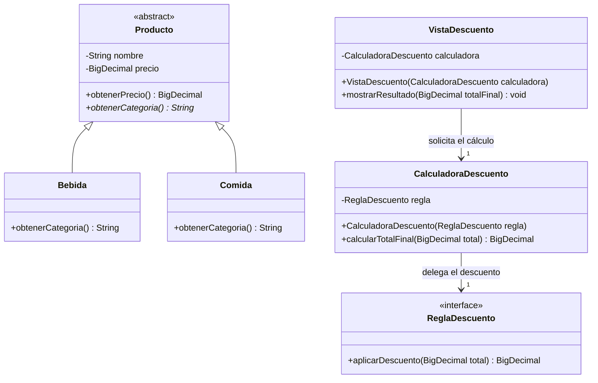

# Unidad I · Diseño y estructura

- **Herencia y polimorfismo.** `Bebida` y `Comida` heredan el nombre y el precio de `Producto`. Cada subclase implementa `obtenerCategoria()`, de modo que una referencia de tipo `Producto` devuelve la categoría correspondiente al objeto concreto.
- **Principio abierto/cerrado.** `ReglaDescuento` define una sola operación. Recibe el total original y devuelve el total final. La calculadora recibe la regla por constructor y delega en ella. Para añadir una promoción, se suministra una nueva implementación de la interfaz, que también puede expresarse como una lambda en la Unidad II.
- **Cohesión y bajo acoplamiento.** La vista lee el monto ingresado y muestra el total que devuelve la calculadora. El modelo concentra el cálculo y carece de dependencias de Swing. El total se recibe como monto porque ese es el dato que solicita la interfaz en el enunciado.
